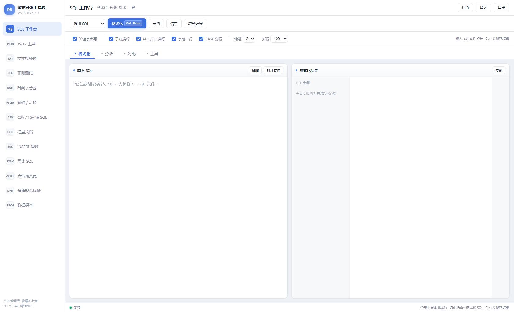
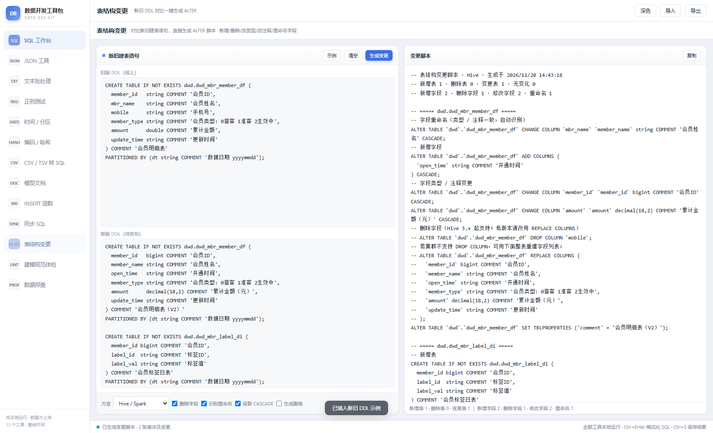
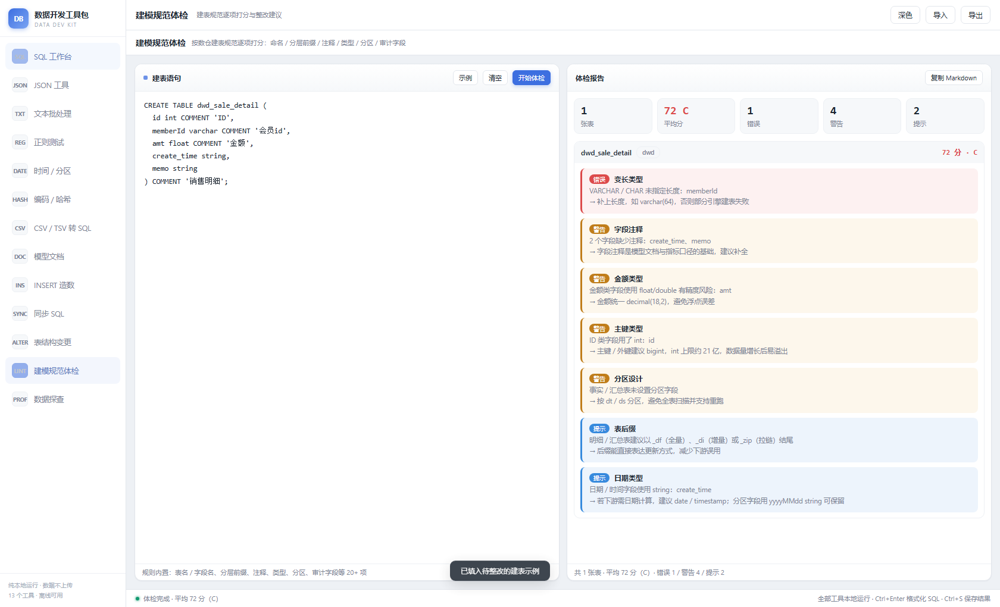
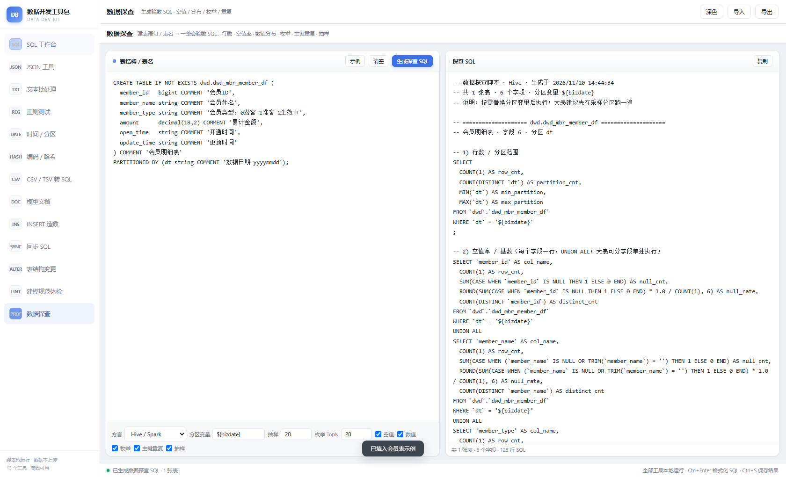

# 数据开发工具包 · Data Dev Kit

> 一个**离线、零依赖、打开即用**的数据开发工具箱。双击一个文件，13 个日常工具全部就位，不装环境、不联网、不上传任何数据。

纯前端：HTML + CSS + JavaScript，没有 `package.json`，没有构建步骤，没有服务端。双击打开 `index.html` 就能跑。



---

## 为什么做这个

数据开发 / 数仓同学的日常，被切碎在太多窗口里：SQL 客户端里调格式、浏览器里查时间戳、记事本里拼 INSERT、Excel 里画模型文档、临时写个脚本验数……每个动作只要 1 分钟，一天下来就是几十次切换和几十次"手滑"。

这个工具包把这些零碎操作收进**一个页面**：

- **不联网**：所有计算在本地完成，页面上没有一次外部请求（可自行用 DevTools 验证）。
- **不装环境**：不需要 Node、Python、数据库客户端，Windows 自带的浏览器就够。
- **不留痕**：不落服务端、不发埋点；唯一的本地存储是你主动收藏的 SQL 片段，一键可清。
- **可改**：源码就是全部，改一行刷新即可生效，没有编译。

---

## 功能总览（13 个工具）

| # | 工具 | 能做什么 |
|:-:|---|---|
| 1 | **SQL 工作台** | 格式化 · 分析 · 对比 · 工具箱：读写表识别、变量面板、风险扫描、字段清单、CTE 大纲、`ID → IN`、`SELECT → DDL`、片段库 |
| 2 | **JSON 工具** | 格式化 · 校验 · 压缩 · 转 INSERT |
| 3 | **文本批处理** | 清洗 · 去重 · 排序 · 加引号 / 去引号 · 大小写 · 前后缀 · 行号 |
| 4 | **正则测试** | 实时匹配 · 分组高亮 · 替换预览 |
| 5 | **时间 / 分区** | 时间戳互转 · 日期加减 · 分区格式生成 · 业务日期推导 |
| 6 | **编码 / 哈希** | Base64 · URL 编解码 · MD5 / SHA-1 / SHA-256 · UUID |
| 7 | **CSV / TSV 转 SQL** | 表格数据一键生成 INSERT / JSON，自动推断类型 |
| 8 | **模型文档** | 建表语句一键转模型设计文档（导出 Excel），自动识别分层、中文名、字段注释 |
| 9 | **INSERT 造数** | 依据表结构生成 INSERT 测试数据，类型感知、可批量 |
| 10 | **同步 SQL 生成** | 建表 DDL · 全量 · 增量 · 拉链表，一套模板直接可用 |
| 11 | **表结构变更** 🆕 | 新旧两版 DDL 对比，一键生成 `ALTER`（Hive / MySQL 方言） |
| 12 | **建模规范体检** 🆕 | 20+ 条建表规范逐项打分（A / B / C），给出整改建议并导出 Markdown |
| 13 | **数据探查** 🆕 | 由 DDL 或表名列表生成验数 SQL：行数、空值率、基数、分布、枚举 TopN、主键重复、抽样 |

---

## 三个新工具

### 11 · 表结构变更（DDL → ALTER）

把"旧版建表语句"和"新版建表语句"贴进左右两栏，直接得到可以执行的 `ALTER`：



- **新增表**：回填完整 `CREATE TABLE`，不用再翻新版 DDL。
- **新增字段**：Hive 生成 `ADD COLUMNS (...) CASCADE`，MySQL 生成 `ADD COLUMN`。
- **改类型 / 改注释**：Hive 用 `CHANGE COLUMN`，MySQL 用 `MODIFY COLUMN`。
- **删字段**：默认**注释掉**并附 `REPLACE COLUMNS` 备选语句 —— 删列不可逆，宁可多一步手改。
- **字段重命名**：按"同类型 + 同非空注释"严格一对一识别，不会把"删一个 + 加一个"误判成重命名。
- **表和字段注释**：Hive 走 `SET TBLPROPERTIES('comment')`，MySQL 走 `COMMENT=`。
- **分区变更**：不自动改，只给告警 —— 分区动错会写坏数据，交给人判断。
- 方言、`CASCADE`、是否生成 `DROP TABLE`、是否识别重命名，全部可开关。

### 12 · 建模规范体检（DDL → 评分报告）

贴一段建表语句，逐表逐字段检查，输出分数 + 等级 + 每一条问题的修改建议：



检查项包括：表名规范（小写 / 长度 / 分层前缀 `ods` `dwd` `dws` `ads` `dim` `tmp` `app` `rpt`）、周期后缀 `_df` `_di` `_zip`、表注释与字段注释、字段命名与保留字、字段长度、`VARCHAR` 缺长度、`DECIMAL` 缺精度、金额字段误用 `FLOAT`、日期用 `STRING`、ID 类字段用 `INT`、分区缺失 / 类型 / 命名 / 注释、审计字段（`etl_time` 等）、主键线索、字段数过多。

扣分制：`error` 扣 10、`warn` 扣 4、`info` 扣 1；**A ≥ 90、B ≥ 75、C ≥ 60**。报告支持一键复制为 Markdown，直接贴进评审单。

### 13 · 数据探查（DDL / 表名 → 验数 SQL）

交付前"这张表到底对不对"，不用再从零写一遍 `COUNT`：



- 输入建表语句或一行一个表名，按字段类型自动挑检查项。
- 生成的分段 SQL：**行数 / 分区范围** → **空值率 + 基数** → **数值分布**（min / max / avg / 负值）→ **金额口径核对** → **枚举 TopN** → **主键重复 TopN** → **时间范围** → **抽样预览**。
- 分区变量默认 `'${bizdate}'`，可改；方言、`LIMIT`、`TopN`、各项检查均可开关。
- 每段都是独立可跑的语句，段落编号自动递增。

---

## 快速开始

**Windows（推荐）**

1. 下载 / 克隆本仓库到任意目录（路径建议不含空格与中文，避免浏览器 `file://` 编码问题）。
2. 双击 `launch.vbs`：会用 Edge（或 Chrome）的 **应用模式** 打开，没有地址栏，窗口自动最大化。
3. 想放到桌面：右键 `launch.vbs` → 发送到 → 桌面快捷方式，再把快捷方式图标换成 `app.ico`。

**任意系统 / 任意浏览器**

直接用浏览器打开 `index.html` 即可，功能完整。只是少了"应用模式"和自动最大化。

> `launch.vbs` 是纯 ASCII 的 VBScript，所有路径在运行时从脚本所在目录推导，放在哪个盘都能用；没装 Chromium 内核浏览器时会退回默认浏览器。`maximize.ps1` 负责把窗口拉满并让标题栏跟主题配色同步（Edge 应用窗口会忽略 `--start-maximized`，所以要补一刀）。

---

## 界面约定

- 左侧导航切换工具，右侧工作区；**每个工具都是"左输入 / 右输出"**，输出区一键复制。
- `Ctrl + S`：把当前工具的结果保存为本地文件（如 `ddl-change.sql`、`ddl-lint.md`、`profile.sql`）。
- 顶部可切换 **浅色 / 深色** 主题，选择会被记住。
- 各工具自带"示例"按钮，不知道怎么填时先点示例。

---

## 设计原则

1. **离线优先**：页面不发起任何外部请求，没有 CDN、没有字体外链、没有埋点。断网也能用，内网也能用。
2. **零依赖**：除了三个哈希算法的压缩版实现，所有逻辑都是手写的原生 JS。
3. **单文件壳**：`index.html` 承载全部样式、结构与交互胶水；算法按模块拆成独立 IIFE，挂在 `window` 上，互不干扰。
4. **改一个工具不影响其它工具**：加功能只需新增一个 section + 一个模块，不需要动构建。

---

## 目录结构

```
data-dev-kit/
├─ index.html          # 全部样式 + 页面结构 + 交互胶水（唯一入口）
├─ formatter.js        # SQL 格式化
├─ analyzer.js         # SQL 分析（读写表、字段、请求行数、风险）
├─ toolkit.js          # SELECT→DDL、ID→IN、片段库等小工具
├─ modeldoc.js         # 建表语句 → 模型设计文档（Excel 导出）
├─ testdata.js         # INSERT 造数
├─ syncsql.js          # 同步 SQL（全量 / 增量 / 拉链）
├─ ddlchange.js        # 新旧 DDL → ALTER（Hive / MySQL）
├─ ddllint.js          # 建模规范体检
├─ profiler.js         # 数据探查 SQL 生成
├─ md5.min.js / sha1.min.js / sha256.min.js   # 哈希实现
├─ launch.vbs          # Windows 启动器（应用模式 + 最大化）
├─ maximize.ps1        # 窗口最大化 + 标题栏配色同步
├─ app.ico / app-256.png
├─ test/smoke.js       # 冒烟测试（node test/smoke.js）
└─ docs/               # 截图
```

模块约定：每个模块是一个 IIFE，导出**一个**全局对象，例如

```js
window.DDLChange = { build: function (oldDdl, newDdl, opts) { /* → { ok, sql, summary, warnings } */ } };
```

输入输出一律用**普通对象 / 字符串**，不碰 DOM —— 这样既能被 `index.html` 调用，也能在 Node 里直接 `require` 做单元测试。

---

## 隐私与安全

- **没有任何网络请求**：代码里没有 `fetch` / `XMLHttpRequest` / `WebSocket` / `sendBeacon`。用 DevTools 的 Network 面板打开看一眼，全是 `file://`。
- **不上传、不埋点、无第三方 SDK**，没有账号体系。
- **本地存储只有两项**：`sqlwb-theme`（浅色 / 深色）、`sqlwb-snips`（你主动收藏的 SQL 片段）。收藏的片段会以明文存在浏览器配置目录里，介意的话：浏览器 DevTools → Application → Local Storage → 删除 `sqlwb-snips`，或直接在无痕窗口使用。
- **剪贴板与文件**：复制按钮只在点击时写剪贴板；粘贴按钮只在点击时读剪贴板；导入文件只读你手动选择的那一个，全程在内存里处理。
- 启动脚本只做两件事：查屏幕分辨率、拉起本地浏览器窗口，不访问网络。

---

## 常见问题

**为什么用 Edge 应用模式？**
去掉地址栏和标签栏，看起来像个桌面应用；独立窗口也方便 `Alt + Tab` 单独切换。不喜欢的话，直接用普通浏览器打开 `index.html` 也一样。

**为什么把窗口最大化的逻辑单独放在 PowerShell 里？**
Chromium 的应用窗口会忽略 `--start-maximized`，只能在窗口出现后用 Win32 API 强制 `ShowWindow`；顺带还能用 `DwmSetWindowAttribute` 让 Windows 标题栏跟随应用的深浅色主题。

**支持 Mac / Linux 吗？**
页面本身完全跨平台，`launch.vbs` 与 `maximize.ps1` 是 Windows 专属的便利脚本。其它系统直接浏览器打开 `index.html`。

**能改成内网静态站点部署吗？**
可以，把除 `launch.vbs` / `maximize.ps1` 之外的文件丢到任意静态服务器即可（注意此时 `localStorage` 按域名隔离）。

---

## 开发

没有构建步骤，改完直接刷新页面。

**加一个新工具**（大约 4 步）：

1. 在 `index.html` 的侧栏加 `<div class="nav-item" data-tool="xxx">`，并加 `<section id="tool-xxx" class="tool">`。
2. 在 `TOOL_NAMES` / `TOOL_DESC` 里补名称与一行描述。
3. 写独立模块 `xxx.js`（IIFE → `window.Xxx`），在页面底部加 `<script src="xxx.js">`。
4. 在交互胶水里绑定按钮，调用模块、渲染结果。

**测试**：模块不碰 DOM，可以直接 `require` 断言，仓库自带一个冒烟测试：

```bash
node test/smoke.js
# ModelDoc   tables=1 cols=4
# DDLChange  {"added":0,...,"addCols":1,...,"modCols":1,...}
# DDLLint    score=100 grade=A e/w/i=0/0/0
# Profiler   tables=1 cols=5 lines=104
# SMOKE OK
```

---

## License

[MIT](LICENSE) © 2026 tianzhenpy